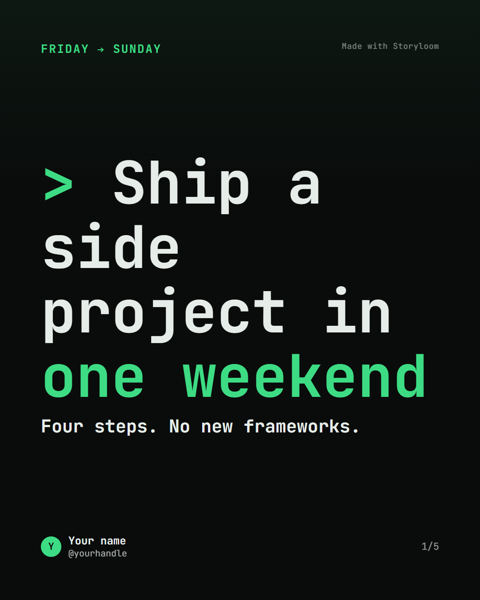

# Storyloom

**Turn an idea, draft, or article into an editable carousel.**

Storyloom helps creators make branded carousels for LinkedIn and Instagram. Start
with your own text, an article URL, or a template; refine the slides in the
studio and export them as images, a PDF, or a ZIP.

## Features

- Generate a 5–10 slide carousel from a topic or draft with Google Gemini.
- Extract article text from a URL and turn it into a carousel.
- Start from a template without using AI.
- Edit slide copy, styles, branding, and order; add or remove slides and undo
  changes, with autosave in the editor.
- Save reusable brand details and apply them to decks.
- Preview and export from the same carousel design for consistent results.
- Optionally sign in, save decks and brands, and manage credits with Supabase.

## Style previews

| Signature African | Editorial Clean | Mono Terminal |
| --- | --- | --- |
|  |  |  |

## Getting started

### Prerequisites

- Node.js 24 (or a compatible version supported by the dependencies)
- npm
- A Google Gemini API key for AI generation (optional)
- A Supabase project for sign-in and persistent decks (optional)

### Install and run

```bash
git clone https://github.com/Kingdomvestor/storyloom.git
cd storyloom
npm install
Copy-Item .env.example .env
npm start
```

On macOS or Linux, replace the `Copy-Item` command with `cp .env.example .env`.
The install/start scripts install Puppeteer's matching Chrome build for
rendering.

Open [http://localhost:3000](http://localhost:3000) to use the studio. Add a
`GEMINI_API_KEY` to `.env` to enable AI generation; without one, you can still
create decks from the built-in templates.

For local development, `npm run dev` starts the server in watch mode.
`npm run dev:degraded` runs the studio without Supabase account configuration
on port 3210 by default.

### Configure accounts (optional)

Storyloom runs without Supabase, but accounts, credits, and saved decks require
a Supabase project. Add the project URL, anon key, and server-only service-role
key to `.env`, then apply the SQL migrations in order. See the
[Supabase setup guide](docs/setup-supabase.md) for the full instructions.

## Usage

1. Choose **Start a carousel**, then paste text, enter an article URL, or pick a
   starter template.
2. Choose a visual style and generate the deck (AI generation requires a
   Gemini API key).
3. Edit the copy and design in the studio, then export PNG slides, a PDF, or a
   ZIP.

To render one of the sample decks from the command line:

```bash
npm run render -- fixtures/sample-5.json
```

The renderer writes one PNG per slide to `out/sample-5/`. Sample files are in
[`fixtures/`](fixtures/).

## Configuration

Copy [`.env.example`](.env.example) to `.env`. Keep real credentials in `.env`;
never commit or expose the Supabase service-role key.

| Variable | Required | Default | Description |
| --- | --- | --- | --- |
| `GEMINI_API_KEY` | For AI generation | — | Server-side Google Gemini API key. Template-based creation works without it. |
| `GEMINI_MODEL` | No | `gemini-3.7-flash` | Primary model used for generation. |
| `GEMINI_FALLBACK_MODELS` | No | `gemini-3.5-flash,gemini-3.5-flash-lite` | Comma-separated fallback models if the primary model is unavailable. |
| `GEMINI_TIMEOUT_MS` | No | `20000` | Timeout for each Gemini request, in milliseconds. |
| `SUPABASE_URL` | For accounts | — | Supabase project URL. |
| `SUPABASE_ANON_KEY` | For accounts | — | Supabase public anon key. |
| `SUPABASE_SERVICE_ROLE_KEY` | For accounts | — | Secret server-side key; never expose it to the browser. |
| `PORT` | No | `3000` | HTTP port for the server. |

Set all three Supabase variables to enable accounts and persistent user data.
Without them, the app runs in single-user mode without accounts or saved decks.

## How it works

```text
Text / article URL / starter template
                 │
                 ▼
       Validated editable deck
                 │
       ┌─────────┴─────────┐
       ▼                   ▼
  Studio preview       PNG / PDF / ZIP
       └─────────┬─────────┘
                 ▼
     Shared carousel template
```

The browser preview and Puppeteer exports use the same HTML template, so the
download matches the editor preview. Deck structure and text limits are defined
in [`schemas/carousel.schema.json`](schemas/carousel.schema.json) and validated
on the server; the studio reads slide limits and text budgets from the API
rather than keeping a separate copy. The template exposes its browser interface
as `window.STORYLOOM`, and the renderer waits for its ready signal before
capturing a slide.

### Tech stack

| Layer | Technology |
| --- | --- |
| Web app | HTML, CSS, vanilla JavaScript, Bootstrap 5 |
| Server | Node.js (ES modules), Express |
| Rendering | Puppeteer and headless Chrome |
| AI generation | Google Gemini API |
| Deck validation | JSON Schema and Ajv |
| Article extraction | Mozilla Readability and jsdom |
| Accounts and persistence | Supabase Auth, Postgres, and Storage |
| Exports | PNG rendering, PDF generation, and ZIP packaging |

When configured, Supabase Auth and Postgres provide user-scoped accounts,
credits, decks, and brands. Database migrations are in
[`supabase/migrations/`](supabase/migrations/).

## API overview

The Express API is served by the same process as the app. Common endpoints:

| Area | Methods and endpoints | Purpose |
| --- | --- | --- |
| Status and configuration | `GET /api/health`, `GET /api/meta`, `GET /api/defaults` | Check server health and load app configuration. |
| Creation and editing | `POST /api/extract`, `/api/generate`, `/api/validate`, `/api/rewrite` | Extract source text, generate and validate decks, and rewrite slide copy. |
| Rendering and export | `POST /api/render`, `POST /api/export` | Preview slides and download PNG, PDF, or ZIP exports. |
| Decks | `GET`, `POST /api/decks`; `GET`, `PUT`, `DELETE /api/decks/:id` | Manage saved decks when accounts are configured. |
| Brands | `GET`, `POST /api/brands`; `PUT`, `DELETE /api/brands/:id` | Manage saved brands when accounts are configured. |
| Styles and templates | `GET /api/styles`, `/api/templates` and admin routes under `/api/admin/` | Load styles and templates; admin operations require admin access. |
| Feedback | `POST /api/feedback`; `GET /api/admin/feedback`, `PATCH /api/admin/feedback/:id` | Submit feedback and manage it as an admin. |

Account-backed endpoints require Supabase configuration and authentication.
Admin endpoints additionally require admin permissions.

## Project structure

```text
storyloom/
├── docs/                   # Setup guides and project documentation
├── fixtures/               # Example decks
├── prompts/                # AI generation prompt
├── public/
│   ├── demo/               # Example slides for each built-in style
│   ├── app.js              # Studio UI
│   ├── app.css              # Studio styles
│   ├── index.html           # Studio and account views
│   └── landing.html         # Public landing page
├── schemas/
│   └── carousel.schema.json
├── src/
│   ├── server.js            # Express API and static routes
│   ├── generate.js          # Gemini generation
│   ├── extract.js           # Article extraction
│   ├── validate.js          # Deck validation and lint
│   └── render.js            # Puppeteer rendering
├── supabase/migrations/     # Database schema changes
├── templates/
│   └── carousel.html        # Shared browser preview and export template
├── test/                    # Node test suite
├── .env.example             # Empty environment-variable template
└── package.json
```

## Scripts

| Command | Purpose |
| --- | --- |
| `npm start` | Start the server. |
| `npm run dev` | Start the server with Node watch mode. |
| `npm run dev:degraded` | Start without Supabase account configuration. |
| `npm test` | Run the automated test suite. |
| `npm run generate` | Run the generation CLI. |
| `npm run extract` | Run the article extraction CLI. |
| `npm run validate` | Run the deck validation CLI. |
| `npm run render -- <deck.json>` | Render a deck to PNG slides. |
| `npm run render:all` | Render the sample decks. |
| `npm run verify:supabase` | Verify Supabase account, credit, and deck operations. |

## Testing

Run the test suite with:

```bash
npm test
```

Tests use Node's built-in test runner. Supabase integration checks are separate
and require a configured project; run `npm run verify:supabase` only after
following the [Supabase setup guide](docs/setup-supabase.md).

## Security

- Keep `GEMINI_API_KEY` and `SUPABASE_SERVICE_ROLE_KEY` server-side in `.env`.
- The Supabase service-role key bypasses row-level security and must never be
  sent to the browser.
- Decks are validated on the server, and export watermark rules are enforced
  server-side.
